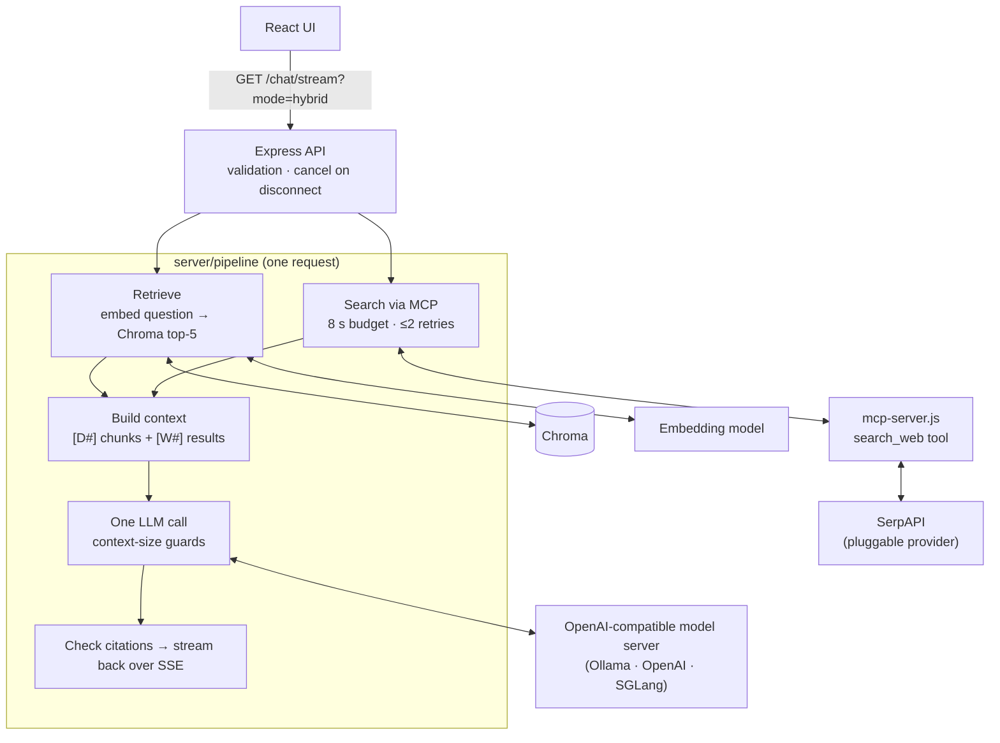

# Agent AI — Hybrid Document + Web Q&A

Ask questions about an uploaded PDF and get **one grounded answer** that cites both
**document chunks** (`[D1]`, with page numbers) and **live web results** (`[W1]`, with URLs).
Web search is a pluggable provider behind an MCP server, and the model runs on any
OpenAI-compatible server (a local Ollama model by default).

The code is meant to be read as a reference integration as well as run:

- **One retrieval pipeline, three modes:** `docs`, `web`, `hybrid`.
- **Provider-neutral web search:** a contract, a SerpAPI adapter and an offline fake. Adding a new search API is one file.
- **Production behaviour:** bounded retries, time budgets that actually cancel work, fallbacks in both directions, and guards against silent context truncation.
- **Measured, not claimed:** an eval harness records the exact model and runtime configuration with every result.

## Contents

- [How a question is answered](#how-a-question-is-answered)
- [Quickstart](#quickstart)
- [API](#api)
- [Configuration](#configuration)
- [Switching model servers](#switching-model-servers)
- [Integrating a different search API](#integrating-a-different-search-api)
- [Using the search tool from other MCP clients](#using-the-search-tool-from-other-mcp-clients)
- [Reliability behaviour](#reliability-behaviour)
- [Testing](#testing)
- [Evaluation](#evaluation)
- [Project layout](#project-layout)
- [Known limitations](#known-limitations)

## How a question is answered



For a `hybrid` question:

1. **Retrieval and search run in parallel.**
   - Retrieval embeds the question (with the query instruction the embedding model expects) and takes the top-5 chunks from the document's own Chroma collection, keeping page numbers.
   - Search calls the `search_web` MCP tool, which returns normalized results: `{title, url, snippet, position, date}`.
2. **The context is built** ([pipeline/context.js](server/pipeline/context.js)):
   - Sources are numbered `[D#]` and `[W#]` and deduplicated: document chunks by content hash, web results by normalized URL.
   - The two lists keep their own order. A Chroma distance and a search rank aren't comparable scores, so they're never mixed into one ranking.
   - The fixed instructions form a system message that is identical for every request. Sources and the question follow it.
3. **One LLM call** produces the answer, streamed over SSE.
   - Before the call, the prompt is checked against the context window.
   - After the call, the server's reported token count is checked for silent truncation (see [Reliability](#reliability-behaviour)).
4. **Citations are checked** against the sources the model was actually given. Unknown labels are reported, not hidden.

### Ingestion

`POST /upload` saves the PDF, records it in Postgres and queues a BullMQ job. The worker then:

1. Splits the PDF into 500-character chunks with 50 characters of overlap.
2. Embeds them in batches.
3. Writes them to a per-document Chroma collection, with deterministic IDs and the page number stored on each chunk.
4. Marks the document `ready` only after confirming that Chroma holds every chunk.

Retries can't duplicate vectors. On startup, every `ready` document is checked against Chroma, so lost vectors surface as an explicit `failed` status instead of empty answers.

## Quickstart

**Prerequisites:** Node 20.3+, Docker, [Ollama](https://ollama.com), and a [SerpAPI](https://serpapi.com) key (only needed for web search).

```bash
git clone <this repo> && cd agentai
```

**1. Models.** About 6 GB to download. The Modelfile fixes the context window: Ollama's default silently truncates long prompts.

```bash
ollama pull qwen3:8b && ollama pull qwen3-embedding:0.6b
```
```bash
ollama create qa-qwen3-8b-32k -f server/models/qwen3-8b-32k.Modelfile
```

**2. Configuration.** Copy the template, then set `SERPAPI_KEY`.

```bash
cp server/.env.example server/.env
```

**3. Run.** Choose one of the two options below.

*Everything except the UI in Docker:*

```bash
docker compose up -d --build postgres redis chroma server
```

*Or the API locally, with only the data services in Docker:*

```bash
docker compose up -d postgres redis chroma
```
```bash
npm install && npm install --prefix server
```
```bash
npm run dev
```

`npm run dev` starts the API on `:5001` and the UI on `:3000`. If you used the Docker option, start just the UI with `npm start`.

On first start, the server ingests the demo document [server/uploads/hbs-lean-startup.pdf](server/uploads/hbs-lean-startup.pdf) (an HBS note on the Lean Startup, 26 pages). Open http://localhost:3000 and ask a question, or use the API directly:

```bash
curl -s localhost:5001/documents/default
```
```bash
curl -s "localhost:5001/chat?mode=hybrid&documentId=<id>&question=What%20is%20a%20pivot%3F"
```

Prometheus (`:9090`) and Grafana (`:3001`) are also defined in [docker-compose.yml](docker-compose.yml). They scrape `GET /metrics`.

## API

| Method & path | Purpose |
|---|---|
| `POST /upload` | Multipart field `file` (PDF). Returns `202 {documentId, status: "processing"}` |
| `GET /documents/:id` | Ingestion status: `processing`, `ready` or `failed` (with `error`) |
| `GET /documents/default` | The demo document |
| `POST /documents/:id/reingest` | Re-embed from the stored file (e.g. after vectors were lost) |
| `GET /chat` | One answer as JSON (parameters below) |
| `GET /chat/stream` | The same answer as Server-Sent Events |
| `GET /runtime` | Exact model, runtime and retrieval configuration (no secrets) |
| `GET /metrics` | Prometheus metrics: latency histogram, `chat_requests_total{endpoint,outcome}` |

### `GET /chat` parameters

| Parameter | Required | Meaning |
|---|---|---|
| `question` | yes | The question |
| `mode` | no | `docs`, `web` or `hybrid` (default `hybrid`) |
| `documentId` | unless `mode=web` | The document to retrieve from |

Response (abridged from a real run):

```json
{
  "answer": "Vanity metrics are superficial data points that look impressive but lack practical value, while actionable metrics provide insights that drive decisions [W3]. ... focus on conversion funnel performance and cohort analysis [D2][D4].",
  "mode": "hybrid",
  "sources": [
    { "id": "D2", "type": "document", "page": 5, "text": "Entrepreneurs often use cohort analysis to track trends in LTV/CAC, ..." },
    { "id": "W3", "type": "web", "title": "What is the difference between vanity and actionable metrics?", "url": "https://www.secoda.co/blog/...", "snippet": "...", "date": null }
  ],
  "citations": { "total": 6, "cited": ["W3", "W5", "D2", "D4", "W1", "W2"], "invalid": [], "uncited": ["D1", "D3", "D5", "W4"] },
  "web": { "status": "ok" },
  "retrieval": { "status": "ok" },
  "meta": {
    "retrieval": { "embed_ms": 518, "chroma_ms": 19, "chunks": 5, "status": "ok" },
    "web": { "search_ms": 1083, "attempts": 1, "results": 5, "status": "ok" },
    "llm": { "ms": 7341, "usage": { "input_tokens": 1093, "output_tokens": 110, "cached_input_tokens": null },
             "check": { "truncation_check": "pass", "prompt_tokens": 1093, "truncation_ruled_out_by": "short_prompt" } },
    "total_ms": 8429
  }
}
```

`cached_input_tokens` is `null` when the model server doesn't report prompt-cache hits. Ollama doesn't; that is not the same as a measured 0.

### `GET /chat/stream` events

| Event | Data |
|---|---|
| `event: sources` | `{sources, web, retrieval}`, sent as soon as retrieval and search finish |
| `data:` (default) | `{token}` for each piece of the answer |
| `data:` (default) | `{done: true, citations, meta}` at the end |
| `event: apierror` | `{status, error, detail}` |

### Error responses

| Status | When |
|---|---|
| 400 | Missing `question`, unknown `mode`, missing `documentId` |
| 404 | Unknown document |
| 409 | Document still processing |
| 422 | Document ingestion failed, its vectors are missing, or the prompt can't fit the model's context |
| 502 | `mode=web` and the search failed or returned nothing |
| 503 | No usable sources (`docs` retrieval failed, or both sides failed in `hybrid`) |

## Configuration

All settings are environment variables in `server/.env`. [server/.env.example](server/.env.example) lists every one with defaults.

| Group | Variables |
|---|---|
| Model | `LLM_RUNTIME` (`openai`, `ollama`, `sglang`, `vllm`), `LLM_BASE_URL`, `LLM_MODEL`, `LLM_CONTEXT_TOKENS`, `LLM_MAX_OUTPUT_TOKENS`, `LLM_DISABLE_THINKING`, `LLM_TEMPERATURE`, `LLM_SEED`, `LLM_TIMEOUT_MS`, `LLM_MAX_RETRIES`, `LLM_API_KEY` |
| Embeddings | `EMBEDDING_MODEL`, `EMBEDDING_BASE_URL` (defaults to `LLM_BASE_URL`), `EMBEDDING_QUERY_INSTRUCTION`, `EMBEDDING_BATCH_SIZE`, `EMBEDDING_TIMEOUT_MS` |
| Retrieval | `RETRIEVAL_TOP_K` (default 5) |
| Web search | `SEARCH_PROVIDER` (`serpapi`, `fake`), `SEARCH_TRANSPORT` (`mcp`, `direct`), `SEARCH_NUM_RESULTS`, `SEARCH_TIMEOUT_MS`, `SEARCH_ATTEMPT_TIMEOUT_MS`, `SEARCH_RETRIES`, `SERPAPI_KEY` |
| Services | `DATABASE_URL`, `CHROMA_URL`, `REDIS_URL`, `PORT`, `SERVER_REQUEST_TIMEOUT_MS` |

Notes:
- `LLM_CONTEXT_TOKENS` must match the model server's real context window. Prompts that can't fit are refused rather than sent.
- Changing `EMBEDDING_MODEL` means re-ingesting documents (`POST /documents/:id/reingest`), because stored vectors only work with the model that produced them.
- The API key in `.env` is never baked into the Docker image ([server/.dockerignore](server/.dockerignore)). Compose passes it in at runtime.

## Switching model servers

Every chat and embedding model is created in [server/lib/llm.js](server/lib/llm.js) and points at an OpenAI-compatible API, so switching servers is configuration only. The one per-server detail is how to turn off a reasoning model's "thinking":

| `LLM_RUNTIME` | How thinking is disabled | Status |
|---|---|---|
| `ollama` | `reasoning_effort: "none"`. Ollama ignores `think: false` on this endpoint (Ollama 0.33) | Verified |
| `openai` | n/a | Supported, not re-measured on this branch |
| `sglang`, `vllm` | `chat_template_kwargs: {enable_thinking: false}` | Implemented, **not yet verified** |

If thinking output appears anyway, the request fails rather than silently inflating latency and token counts.

Inside Docker, the server reaches a model server on the host through `host.docker.internal`. Set `DOCKER_LLM_BASE_URL` to use another server. When `LLM_BASE_URL` is set, the key sent is `LLM_API_KEY`, not `OPENAI_API_KEY`.

## Integrating a different search API

Everything after the provider (the MCP tool, context building, citations, the UI) only sees the normalized result shape, so a new search API needs one adapter:

1. **Create `server/search/<name>.js`** exporting a factory that returns `{ name, search(query, { num, signal }) }`, resolving to normalized results. Use `normalizeResult()` from [search/provider.js](server/search/provider.js) to validate and trim each item.
2. **Classify failures.** Throw `SearchProviderError` with `status` and `retryable`:

   | `retryable` | Cases |
   |---|---|
   | `true` | Rate limits, 5xx, timeouts, network errors |
   | `false` | Bad credentials, exhausted quota, other 4xx |

   Retries and the time budget are applied for you. Resolve `[]` for "no results"; that's not an error.
3. **Honour `signal`.** Pass it to `fetch` so cancelled requests stop.
4. **Register it** in `PROVIDERS` in [search/index.js](server/search/index.js) and set `SEARCH_PROVIDER=<name>`.
5. **Test it** with a substituted `fetch`. [test/retry.test.js](server/test/retry.test.js) does this for SerpAPI: every status code, timeouts, cancellation, and that the API key never appears in error messages.

[search/serpapi.js](server/search/serpapi.js) is the reference adapter (about 90 lines).

## Using the search tool from other MCP clients

[server/mcp-server.js](server/mcp-server.js) is a standalone stdio MCP server exposing `search_web(query, num?)`. It returns structured results, sets `isError` on failure, and stops work when the client cancels. To use it from another MCP client (for example Claude Desktop):

```json
{
  "mcpServers": {
    "web-search": {
      "command": "node",
      "args": ["/absolute/path/to/agentai/server/mcp-server.js"],
      "env": { "SEARCH_PROVIDER": "serpapi", "SERPAPI_KEY": "..." }
    }
  }
}
```

The server doesn't read `.env` itself, so pass its settings in `env`. Inside this app, `SEARCH_TRANSPORT=direct` skips MCP and calls the provider in-process, which is useful for measuring the cost of the stdio hop.

## Reliability behaviour

| Situation | Behaviour |
|---|---|
| Search slow | Each SerpAPI attempt times out after `SEARCH_ATTEMPT_TIMEOUT_MS` (3 s). The whole search, including retries, gets `SEARCH_TIMEOUT_MS` (8 s), after which it's **cancelled**, including inside the MCP server |
| Search fails | Up to `SEARCH_RETRIES` (2) retries, with exponential backoff and full jitter, for retryable failures only. `hybrid` then answers from the document, and `web.status` (`error`, `timeout`, `empty`) says why |
| Chroma or embeddings down | `hybrid` answers from the web and `retrieval.status` says why. `docs` returns 503 |
| Both down | 503, "No sources available" |
| Client disconnects | The search and the LLM request are aborted, so generation stops |
| Prompt too large | Refused before sending if it can't possibly fit. After the call, the server-reported token count must rule out truncation, otherwise the request fails. Ollama silently keeps `num_ctx/2 + 2` tokens of an over-long prompt; this check caught 7 of 10 truncated prompts in the original design |
| Model or embedding errors | LLM calls have a timeout and at most 2 retries. Permanent errors (bad key, no credits) fail immediately: LangChain's own handler doesn't recognise OpenAI's `credit_balance_exhausted` and retried it for about 90 s |
| Database errors | Every route forwards async errors to an error handler. In Express 4 an unhandled async rejection would otherwise exit the process |
| Lost vectors | Startup reconciliation marks affected documents `failed` with a reason. A query that retrieves nothing does the same instead of answering from empty context |

## Testing

```bash
npm test --prefix server
```
```bash
CI=true npm test
```

The first runs the server suite: 59 tests with Node's built-in test runner. It covers retries and backoff, SerpAPI status classification, cancellation, both fallbacks, the time budget, MCP concurrency and cancellation, context building, citations, the truncation guards, and reconciliation. One integration test needs Chroma running and is skipped otherwise.

The second runs the frontend suite (4 component tests): citation tags, source list and fallback notices.

To exercise failure paths by hand without spending search quota, run a second API from `server/` with the fake provider:

```bash
SEARCH_PROVIDER=fake FAKE_SEARCH_MODE=transient PORT=5002 node server.js
```

`FAKE_SEARCH_MODE` also accepts `ok`, `empty`, `error` and `hang`.

## Evaluation

```bash
EVAL_MODE=hybrid node scripts/eval.js --documentId=<id>
```

Run that from `server/`. It asks the 10 questions in [scripts/eval.js](server/scripts/eval.js) through `/chat`, has an LLM judge grade each answer against a reference, and writes `server/results/eval-<timestamp>.json`. Each file contains every answer, its sources, citations, per-stage timings, token counts, the server's `/runtime` record (model digests, quantization, context size) and the git commit.

Results so far. Environment: MacBook M3 Pro 18 GB, Ollama 0.33.2, Qwen3-8B Q4_K_M with a 32k context, Qwen3-Embedding-0.6B, top-5 chunks. One run each. The judge is the same Qwen3-8B model and **has not been calibrated against human labels**.

| Run | Requests completed | Judged correct | LLM calls per question | Input tokens per question | Median latency (warm) |
|---|---|---|---|---|---|
| Original design: two pipelines, two answers ([`baseline-dual`](server/results/eval-2026-10-18T06-07-34-126Z.json)) | 3/10 | 3/10 | 2 | ~29.5k (web) + ~0.6k (doc) | 263–332 s (all 3) |
| Original document pipeline only ([results](server/results/eval-2026-10-18T06-14-01-156Z.json)) | 10/10 | 10/10 | 1 | 542–723 | 9.8 s |
| `docs` mode ([results](server/results/eval-2026-10-18T07-16-11-627Z.json)) | 10/10 | 8/10 | 1 | 707–890 | 7.3 s |
| `hybrid` mode ([results](server/results/eval-2026-10-18T07-18-49-182Z.json)) | 10/10 | 10/10 | 1 | 1,036–1,235 | 7.8 s |

How to read this:
- **The original design** sent SerpAPI's raw JSON to the model, 50–74k characters per question. That exceeded the 32k context for 7 of 10 questions, and those requests failed on the truncation guard. Ollama processes one request at a time here (`OLLAMA_NUM_PARALLEL=1`), so its two "parallel" pipelines actually ran one after the other.
- **`docs` mode's 8/10 is grounded behaviour, not a regression.** Q5 and Q6 ask about "innovation accounting" and "vanity/actionable metrics", which the PDF never mentions. The original pipeline's passes on them came from the model's own knowledge. `hybrid` answers both from cited web sources.
- **These questions are too easy** to tell configurations apart. A harder, labelled dataset is the next step.
- These numbers come from one local machine. Don't compare them with measurements from a different model server or GPU.

## Project layout

```
server/
  server.js             Express routes, SSE, error mapping, startup reconciliation
  pipeline/             answer.js (modes, fallbacks, cancellation), retrieve.js,
                        context.js (sources + prompt), citations.js
  search/               provider.js (contract), serpapi.js, fake.js, retry.js,
                        index.js (provider/transport selection), mcp-client.js
  mcp-server.js         search_web MCP tool (stdio)
  lib/                  llm.js (model factory), guards.js (truncation/thinking),
                        errors.js, vectors.js, reconcile.js, queue.js,
                        runtime-info.js, usage.js
  ingest.js             PDF -> chunks -> embeddings -> Chroma (idempotent)
  db/                   Postgres document records
  models/               Ollama Modelfile (context window)
  scripts/              eval.js, benchmark.js
  results/              committed eval results
  test/                 node:test suites
src/                    React UI (ChatComponent, RenderQA, PdfUploader)
docker-compose.yml      postgres, redis, chroma, server, prometheus, grafana
```

## Known limitations

- **Search query quality.** The raw question is sent as the search query. A long natural-language question can return irrelevant results; one asking for "well-known examples" returned Wells Fargo and wellness sites. The model ignored them, but query rewriting would cost an extra LLM call and hasn't been measured yet.
- **Citation validity is not faithfulness.** The checker confirms that labels exist, not that the cited source supports the sentence.
- **The eval is small:** 10 easy definition questions, two of them not answerable from the document, graded by an uncalibrated judge, with no retrieval metrics yet.
- **SGLang and vLLM thinking control and overflow behaviour aren't verified yet.** Until they are, the truncation check fails closed on long prompts for those runtimes.
- **`benchmark.js`** only measures end-to-end `/chat` latency (default `hybrid`, sequential). It doesn't break down stages or compare modes, and doesn't test concurrency yet.
- **`multer` 1.x** (the upload handler) has published vulnerabilities fixed in 2.x and should be upgraded.
- **Query routing** (deciding when web search is worth its latency) isn't implemented. Every `hybrid` question searches.
