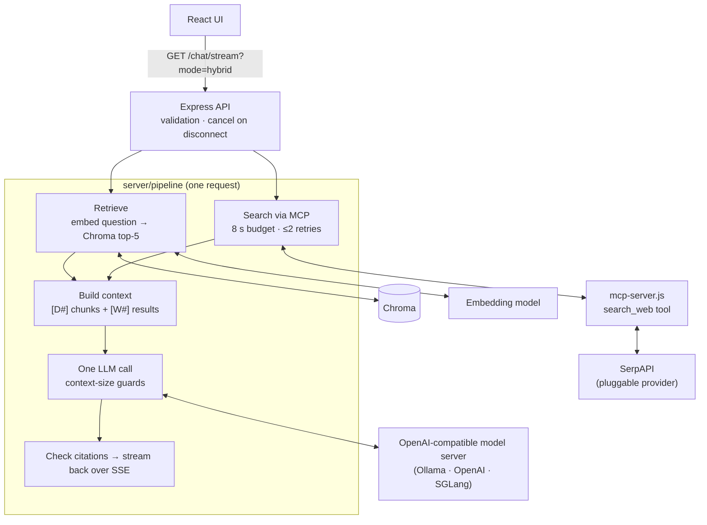

# Agent AI — Hybrid Document + Web Q&A

Ask questions about an uploaded PDF and get **one grounded answer** that cites both
**document chunks** (`[D1]`, with page numbers) and **live web results** (`[W1]`, with URLs).
Web search is a pluggable provider behind an MCP server, and the model runs on any
OpenAI-compatible server (a local Ollama model by default).

The code is meant to be read as a reference integration as well as run:

- **One retrieval pipeline, three modes:** `docs`, `web`, `hybrid`.
- **Provider-neutral web search:** a contract, a SerpAPI adapter and an offline fake. Adding a new search API is one file.
- **Production behaviour:** bounded retries, time budgets that actually cancel work, fallbacks in both directions, and guards against silent context truncation.
- **Measured, not claimed:** an eval harness records the exact model and runtime configuration with every result.

## Contents

- [How a question is answered](#how-a-question-is-answered)
- [Quickstart](#quickstart)
- [API](#api)
- [Configuration](#configuration)
- [Switching model servers](#switching-model-servers)
- [Integrating a different search API](#integrating-a-different-search-api)
- [Using the search tool from other MCP clients](#using-the-search-tool-from-other-mcp-clients)
- [Reliability behaviour](#reliability-behaviour)
- [Testing](#testing)
- [Evaluation](#evaluation)
- [Project layout](#project-layout)
- [Known limitations](#known-limitations)

## How a question is answered



For a `hybrid` question:

1. **Retrieval and search run in parallel.**
   - Retrieval embeds the question (with the query instruction the embedding model expects) and takes the top-5 chunks from the document's own Chroma collection, keeping page numbers.
   - Search calls the `search_web` MCP tool, which returns normalized results: `{title, url, snippet, position, date}`.
2. **The context is built** ([pipeline/context.js](server/pipeline/context.js)):
   - Sources are numbered `[D#]` and `[W#]` and deduplicated: document chunks by content hash, web results by normalized URL.
   - The two lists keep their own order. A Chroma distance and a search rank aren't comparable scores, so they're never mixed into one ranking.
   - The fixed instructions form a system message that is identical for every request. Sources and the question follow it.
3. **One LLM call** produces the answer, streamed over SSE.
   - Before the call, the prompt is checked against the context window.
   - After the call, the server's reported token count is checked for silent truncation (see [Reliability](#reliability-behaviour)).
4. **Citations are checked** against the sources the model was actually given. Unknown labels are reported, not hidden.

### Ingestion

`POST /upload` saves the PDF, records it in Postgres and queues a BullMQ job. The worker then:

1. Splits the PDF into 500-character chunks with 50 characters of overlap.
2. Embeds them in batches.
3. Writes them to a per-document Chroma collection, with deterministic IDs and the page number stored on each chunk.
4. Marks the document `ready` only after confirming that Chroma holds every chunk.

Retries can't duplicate vectors. On startup, every `ready` document is checked against Chroma, so lost vectors surface as an explicit `failed` status instead of empty answers.

## Quickstart

**Prerequisites:** Node 20.3+, Docker, [Ollama](https://ollama.com), and a [SerpAPI](https://serpapi.com) key (only needed for web search).

```bash
git clone <this repo> && cd agentai
```

**1. Models.** About 6 GB to download. The Modelfile fixes the context window: Ollama's default silently truncates long prompts.

```bash
ollama pull qwen3:8b && ollama pull qwen3-embedding:0.6b
```
```bash
ollama create qa-qwen3-8b-32k -f server/models/qwen3-8b-32k.Modelfile
```

**2. Demo document.** Downloads the GPT-4 Technical Report (arXiv:2303.08774v3) and checks its SHA-256. The PDF isn't committed: arXiv's license doesn't let us redistribute it.

```bash
sh server/scripts/fetch-demo-doc.sh
```

**3. Configuration.** Copy the template, then set `SERPAPI_KEY`.

```bash
cp server/.env.example server/.env
```

**4. Run.** Choose one of the two options below.

*Everything except the UI in Docker:*

```bash
docker compose up -d --build postgres redis chroma server
```

*Or the API locally, with only the data services in Docker:*

```bash
docker compose up -d postgres redis chroma
```
```bash
npm install && npm install --prefix server
```
```bash
npm run dev
```

`npm run dev` starts the API on `:5001` and the UI on `:3000`. If you used the Docker option, start just the UI with `npm start`.

On first start, the server ingests the demo document, the [GPT-4 Technical Report](https://arxiv.org/abs/2303.08774v3) (OpenAI, 100 pages, 682 chunks). It's a useful test case for hybrid retrieval: it is frozen at March 2023, deliberately omits some details (e.g. model size), and contains benchmark tables. Open http://localhost:3000 and ask a question, or use the API directly:

```bash
curl -s localhost:5001/documents/default
```
```bash
curl -s "localhost:5001/chat?mode=hybrid&documentId=<id>&question=What%20percentile%20did%20GPT-4%20reach%20on%20the%20bar%20exam%3F"
```

Prometheus (`:9090`) and Grafana (`:3001`) are also defined in [docker-compose.yml](docker-compose.yml). They scrape `GET /metrics`.

## API

| Method & path | Purpose |
|---|---|
| `POST /upload` | Multipart field `file` (PDF). Returns `202 {documentId, status: "processing"}` |
| `GET /documents/:id` | Ingestion status: `processing`, `ready` or `failed` (with `error`) |
| `GET /documents/default` | The demo document |
| `POST /documents/:id/reingest` | Re-embed from the stored file (e.g. after vectors were lost) |
| `GET /chat` | One answer as JSON (parameters below) |
| `GET /chat/stream` | The same answer as Server-Sent Events |
| `GET /runtime` | Exact model, runtime and retrieval configuration (no secrets) |
| `GET /metrics` | Prometheus metrics: latency histogram, `chat_requests_total{endpoint,outcome}` |

### `GET /chat` parameters

| Parameter | Required | Meaning |
|---|---|---|
| `question` | yes | The question |
| `mode` | no | `docs`, `web` or `hybrid` (default `hybrid`) |
| `documentId` | unless `mode=web` | The document to retrieve from |

Response (abridged from a real run):

```json
{
  "answer": "Vanity metrics are superficial data points that look impressive but lack practical value, while actionable metrics provide insights that drive decisions [W3]. ... focus on conversion funnel performance and cohort analysis [D2][D4].",
  "mode": "hybrid",
  "sources": [
    { "id": "D2", "type": "document", "page": 5, "text": "Entrepreneurs often use cohort analysis to track trends in LTV/CAC, ..." },
    { "id": "W3", "type": "web", "title": "What is the difference between vanity and actionable metrics?", "url": "https://www.secoda.co/blog/...", "snippet": "...", "date": null }
  ],
  "citations": { "total": 6, "cited": ["W3", "W5", "D2", "D4", "W1", "W2"], "invalid": [], "uncited": ["D1", "D3", "D5", "W4"] },
  "web": { "status": "ok" },
  "retrieval": { "status": "ok" },
  "meta": {
    "retrieval": { "embed_ms": 518, "chroma_ms": 19, "chunks": 5, "status": "ok" },
    "web": { "search_ms": 1083, "attempts": 1, "results": 5, "status": "ok" },
    "llm": { "ms": 7341, "usage": { "input_tokens": 1093, "output_tokens": 110, "cached_input_tokens": null },
             "check": { "truncation_check": "pass", "prompt_tokens": 1093, "truncation_ruled_out_by": "short_prompt" } },
    "total_ms": 8429
  }
}
```

`cached_input_tokens` is `null` when the model server doesn't report prompt-cache hits. Ollama doesn't; that is not the same as a measured 0.

### `GET /chat/stream` events

| Event | Data |
|---|---|
| `event: sources` | `{sources, web, retrieval}`, sent as soon as retrieval and search finish |
| `data:` (default) | `{token}` for each piece of the answer |
| `data:` (default) | `{done: true, citations, meta}` at the end |
| `event: apierror` | `{status, error, detail}` |

### Error responses

| Status | When |
|---|---|
| 400 | Missing `question`, unknown `mode`, missing `documentId` |
| 404 | Unknown document |
| 409 | Document still processing |
| 422 | Document ingestion failed, its vectors are missing, or the prompt can't fit the model's context |
| 502 | `mode=web` and the search failed or returned nothing |
| 503 | No usable sources (`docs` retrieval failed, or both sides failed in `hybrid`) |

## Configuration

All settings are environment variables in `server/.env`. [server/.env.example](server/.env.example) lists every one with defaults.

| Group | Variables |
|---|---|
| Model | `LLM_RUNTIME` (`openai`, `ollama`, `sglang`, `vllm`), `LLM_BASE_URL`, `LLM_MODEL`, `LLM_CONTEXT_TOKENS`, `LLM_MAX_OUTPUT_TOKENS`, `LLM_DISABLE_THINKING`, `LLM_TEMPERATURE`, `LLM_SEED`, `LLM_TIMEOUT_MS`, `LLM_MAX_RETRIES`, `LLM_API_KEY` |
| Embeddings | `EMBEDDING_MODEL`, `EMBEDDING_BASE_URL` (defaults to `LLM_BASE_URL`), `EMBEDDING_QUERY_INSTRUCTION`, `EMBEDDING_BATCH_SIZE`, `EMBEDDING_TIMEOUT_MS` |
| Retrieval | `RETRIEVAL_TOP_K` (default 5) |
| Web search | `SEARCH_PROVIDER` (`serpapi`, `fake`), `SEARCH_TRANSPORT` (`mcp`, `direct`), `SEARCH_NUM_RESULTS`, `SEARCH_TIMEOUT_MS`, `SEARCH_ATTEMPT_TIMEOUT_MS`, `SEARCH_RETRIES`, `SERPAPI_KEY` |
| Services | `DATABASE_URL`, `CHROMA_URL`, `REDIS_URL`, `PORT`, `SERVER_REQUEST_TIMEOUT_MS` |

Notes:
- `LLM_CONTEXT_TOKENS` must match the model server's real context window. Prompts that can't fit are refused rather than sent.
- Changing `EMBEDDING_MODEL` means re-ingesting documents (`POST /documents/:id/reingest`), because stored vectors only work with the model that produced them.
- The API key in `.env` is never baked into the Docker image ([server/.dockerignore](server/.dockerignore)). Compose passes it in at runtime.

## Switching model servers

Every chat and embedding model is created in [server/lib/llm.js](server/lib/llm.js) and points at an OpenAI-compatible API, so switching servers is configuration only. The one per-server detail is how to turn off a reasoning model's "thinking":

| `LLM_RUNTIME` | How thinking is disabled | Status |
|---|---|---|
| `ollama` | `reasoning_effort: "none"`. Ollama ignores `think: false` on this endpoint (Ollama 0.33) | Verified |
| `openai` | n/a | Supported, not re-measured on this branch |
| `sglang`, `vllm` | `chat_template_kwargs: {enable_thinking: false}` | Implemented, **not yet verified** |

If thinking output appears anyway, the request fails rather than silently inflating latency and token counts.

Inside Docker, the server reaches a model server on the host through `host.docker.internal`. Set `DOCKER_LLM_BASE_URL` to use another server. When `LLM_BASE_URL` is set, the key sent is `LLM_API_KEY`, not `OPENAI_API_KEY`.

## Integrating a different search API

Everything after the provider (the MCP tool, context building, citations, the UI) only sees the normalized result shape, so a new search API needs one adapter:

1. **Create `server/search/<name>.js`** exporting a factory that returns `{ name, search(query, { num, signal }) }`, resolving to normalized results. Use `normalizeResult()` from [search/provider.js](server/search/provider.js) to validate and trim each item.
2. **Classify failures.** Throw `SearchProviderError` with `status` and `retryable`:

   | `retryable` | Cases |
   |---|---|
   | `true` | Rate limits, 5xx, timeouts, network errors |
   | `false` | Bad credentials, exhausted quota, other 4xx |

   Retries and the time budget are applied for you. Resolve `[]` for "no results"; that's not an error.
3. **Honour `signal`.** Pass it to `fetch` so cancelled requests stop.
4. **Register it** in `PROVIDERS` in [search/index.js](server/search/index.js) and set `SEARCH_PROVIDER=<name>`.
5. **Test it** with a substituted `fetch`. [test/retry.test.js](server/test/retry.test.js) does this for SerpAPI: every status code, timeouts, cancellation, and that the API key never appears in error messages.

[search/serpapi.js](server/search/serpapi.js) is the reference adapter (about 90 lines).

## Using the search tool from other MCP clients

[server/mcp-server.js](server/mcp-server.js) is a standalone stdio MCP server exposing `search_web(query, num?)`. It returns structured results, sets `isError` on failure, and stops work when the client cancels. To use it from another MCP client (for example Claude Desktop):

```json
{
  "mcpServers": {
    "web-search": {
      "command": "node",
      "args": ["/absolute/path/to/agentai/server/mcp-server.js"],
      "env": { "SEARCH_PROVIDER": "serpapi", "SERPAPI_KEY": "..." }
    }
  }
}
```

The server doesn't read `.env` itself, so pass its settings in `env`. Inside this app, `SEARCH_TRANSPORT=direct` skips MCP and calls the provider in-process, which is useful for measuring the cost of the stdio hop.

## Reliability behaviour

| Situation | Behaviour |
|---|---|
| Search slow | Each SerpAPI attempt times out after `SEARCH_ATTEMPT_TIMEOUT_MS` (3 s). The whole search, including retries, gets `SEARCH_TIMEOUT_MS` (8 s), after which it's **cancelled**, including inside the MCP server |
| Search fails | Up to `SEARCH_RETRIES` (2) retries, with exponential backoff and full jitter, for retryable failures only. `hybrid` then answers from the document, and `web.status` (`error`, `timeout`, `empty`) says why |
| Chroma or embeddings down | `hybrid` answers from the web and `retrieval.status` says why. `docs` returns 503 |
| Both down | 503, "No sources available" |
| Client disconnects | The search and the LLM request are aborted, so generation stops |
| Prompt too large | Refused before sending if it can't possibly fit. After the call, the server-reported token count must rule out truncation, otherwise the request fails. Ollama silently keeps `num_ctx/2 + 2` tokens of an over-long prompt; this check caught 7 of 10 truncated prompts in the original design |
| Model or embedding errors | LLM calls have a timeout and at most 2 retries. Permanent errors (bad key, no credits) fail immediately: LangChain's own handler doesn't recognise OpenAI's `credit_balance_exhausted` and retried it for about 90 s |
| Database errors | Every route forwards async errors to an error handler. In Express 4 an unhandled async rejection would otherwise exit the process |
| Lost vectors | Startup reconciliation marks affected documents `failed` with a reason. A query that retrieves nothing does the same instead of answering from empty context |

## Testing

```bash
npm test --prefix server
```
```bash
CI=true npm test
```

The first runs the server suite: 79 tests with Node's built-in test runner. It covers retries and backoff, SerpAPI status classification, cancellation, both fallbacks, the time budget, MCP concurrency and cancellation, context building, citations, the truncation guards, reconciliation, and the evaluation scoring helpers. One integration test needs Chroma running and is skipped otherwise.

The second runs the frontend suite (4 component tests): citation tags, source list and fallback notices.

To exercise failure paths by hand without spending search quota, run a second API from `server/` with the fake provider:

```bash
SEARCH_PROVIDER=fake FAKE_SEARCH_MODE=transient PORT=5002 node server.js
```

`FAKE_SEARCH_MODE` also accepts `ok`, `empty`, `error` and `hang`.

## Evaluation

**Dataset:** [server/eval/datasets/gpt4-report.v1.json](server/eval/datasets/gpt4-report.v1.json), 35 questions about the GPT-4 Technical Report, reviewed and approved by hand. Each document question has gold pages and a verbatim evidence quote; `npm run eval:validate --prefix server` checks every quote against the PDF.

| Category | Questions | Where the answer is |
|---|---|---|
| `doc_prose` | 13 | the report's text |
| `doc_table` | 8 | a table in the report (columns come out glued together) |
| `doc_undisclosed` | 4 | the report says it withholds this (model size, hardware, compute, data) |
| `web` | 5 | only on the web (after March 2023) |
| `mixed` | 5 | one part in the report, one part on the web |

### Three questions, measured separately

1. **End-to-end:** with the evidence the system actually retrieves, does the answer match the reference?
2. **Retrieval:** was the gold evidence in that context at all?
3. **Generator:** with the gold evidence guaranteed present, does the model answer correctly?

How it's measured, from `server/`:

1. **Capture** every question's prompts once ([eval/capture-contexts.js](server/eval/capture-contexts.js)). This runs the production `prepareContext` with real retrieval and one real search, then builds an **oracle** variant: chunks containing each evidence quote replace the lowest-ranked retrieved chunks, and a reviewed excerpt ([web-evidence file](server/eval/datasets/gpt4-report.v1.web-evidence.json)) replaces the lowest-ranked web result. Raw SerpAPI metadata is kept; the output is git-ignored because it contains report text.
2. **Replay** the frozen prompts to the model ([eval/replay-contexts.js](server/eval/replay-contexts.js)). Each prompt must match its recorded SHA-1, and nothing is retrieved or searched again.
3. **Grade blind** by hand ([eval/make-replay-sheet.js](server/eval/make-replay-sheet.js)): `correct` (correct / partial / incorrect / abstained) and `grounded` (every claim supported by the sources shown; a true fact from the model's memory counts as ungrounded).
4. **Score** ([eval/score-replay.js](server/eval/score-replay.js)). The headline metric is **grounded-correct**: correct and grounded.

```bash
node eval/capture-contexts.js --documentId=<id>
```
```bash
node eval/replay-contexts.js --frozen=eval/frozen/contexts-<ts>.json
```
```bash
node eval/score-replay.js --sheet=eval/frozen/labels/replay-<run>.csv
```

### Results (2026-10-21, hybrid mode)

Qwen3-8B Q4_K_M on Ollama 0.33.2 (MacBook M3 Pro 18 GB), Qwen3-Embedding-0.6B, top-5 chunks, 500-character chunks. One capture, one run, 56 answers graded by one person. Results: [replay](server/results/replay-2026-10-21T10-55-01-709Z.json), [scores](server/results/replay-score-2026-10-21T10-55-01-709Z.json), [labels](server/eval/labels/replay-2026-10-21T10-55-01-709Z.labels.json).

| Layer | Result |
|---|---|
| **1. End-to-end** (retrieved evidence) | **20/35 grounded-correct** (21/35 correct) |
| **2. Retrieval** (gold evidence in the retrieved context) | 18/35 sufficient, 1 partial, 16 missing; document evidence 17/30, web evidence 4/10 |
| **3. Generator** (gold evidence present) | **26/35 grounded-correct** (29/35 correct) |

| Category | End-to-end | With gold evidence |
|---|---|---|
| `doc_prose` (13) | 10 | 11 |
| `doc_table` (8) | 4 | **8** |
| `doc_undisclosed` (4) | 3 | 2 |
| `web` (5) | 1 | 2 |
| `mixed` (5) | 2 | 3 |

**Per question:** 19 work end to end. **7 fail because of retrieval** (P10, T03, T04, T05, T06, W04, M03): wrong with the retrieved evidence, grounded-correct with the gold evidence. **8 fail even with the gold evidence** (P01, P06, U01, W01, W02, W03, M04, M05), and in 1 the extra evidence made the answer worse (U03).

What this shows:
- **Retrieval is the larger bottleneck.** Every evidence quote is stored in Chroma; the failures are ranking (the right chunk isn't in the top 5), not ingestion. Table questions go from 4/8 to 8/8 with the right chunk.
- **The model's failures are mostly source conflicts:** stating an unofficial web figure as fact even with the report's "not disclosed" sentence in context (U01), picking the wrong date when sources disagree (W01, W02), attributing a web figure to the report (M05), or adding unsupported claims (W03, U03).
- **With evidence missing, Qwen abstained correctly on P10, T03 and T04**, but used misleading numbers instead of abstaining when the context offered them (T05, T06, W04).
- **Latency:** generation P50 5.9 s, P95 8.5 s on retrieved contexts; about 1.2k input tokens per question. Searches that succeeded took P50 0.75 s; 2 of 35 timed out against the 3 s per-attempt limit.

Caveats:
- **The layer-2 check is strict:** it only counts the chunk holding the dataset's evidence quote. Four questions it calls "missing" were answered correctly and grounded from other chunks (P02, U02, U04, M01), so usable evidence is closer to 22/35.
- **The oracle adds the gold evidence but leaves the other sources in place**, so layer 3 measures the model with gold evidence among noise.
- **One grader, n = 35, one run.** A few labels are judgement calls (noted per answer in the labels file).
- **No other model has been measured on these contexts**, so these results don't say how much a stronger model would help.

### Earlier results

[scripts/eval.js](server/scripts/eval.js) runs the dataset live through `/chat` and grades with an LLM judge. Its 2026-10-20 runs ([docs](server/results/eval-2026-10-20T00-56-34-170Z.json), [web](server/results/eval-2026-10-20T01-07-20-397Z.json), [hybrid](server/results/eval-2026-10-20T01-20-53-949Z.json)) used the same Qwen3-8B as judge, which turned out **too lenient to trust**: it passed most "I don't know" answers and some wrong facts. Their judged pass rates (30/35, 23/35, 29/35) are not quality numbers. The retrieval metrics and latencies in those files are still valid.

The first runs used the **earlier demo document** (an HBS teaching note on the Lean Startup, removed because its license didn't allow redistribution) and 10 easy questions. They show the effect of the redesign on prompt size and latency, not answer quality:

| Run | Requests completed | LLM calls per question | Input tokens per question | Median latency (warm) |
|---|---|---|---|---|
| Original design: two pipelines, two answers ([`baseline-dual`](server/results/eval-2026-10-18T06-07-34-126Z.json)) | 3/10 | 2 | ~29.5k (web) + ~0.6k (doc) | 263–332 s (all 3) |
| `hybrid` mode after the redesign ([results](server/results/eval-2026-10-18T07-18-49-182Z.json)) | 10/10 | 1 | 1,036–1,235 | 7.8 s |

The original design sent SerpAPI's raw JSON to the model, 50–74k characters per question, which exceeded the 32k context for 7 of 10 questions; the truncation guard caught each one.

These numbers come from one local machine. Don't compare them with measurements from a different model server or GPU.

## Project layout

```
server/
  server.js             Express routes, SSE, error mapping, startup reconciliation
  pipeline/             answer.js (modes, fallbacks, cancellation), retrieve.js,
                        context.js (sources + prompt), citations.js
  search/               provider.js (contract), serpapi.js, fake.js, retry.js,
                        index.js (provider/transport selection), mcp-client.js
  mcp-server.js         search_web MCP tool (stdio)
  lib/                  llm.js (model factory), guards.js (truncation/thinking),
                        errors.js, vectors.js, reconcile.js, queue.js,
                        runtime-info.js, usage.js
  ingest.js             PDF -> chunks -> embeddings -> Chroma (idempotent)
  db/                   Postgres document records
  models/               Ollama Modelfile (context window)
  scripts/              eval.js (live eval through /chat), benchmark.js
  eval/                 datasets/ (questions, gold evidence, web excerpts),
                        capture-contexts.js, replay-contexts.js, make-replay-sheet.js,
                        score-replay.js, validate-dataset.js, labels/ (human labels),
                        frozen/ (captured prompts, git-ignored)
  results/              committed eval results
  test/                 node:test suites
src/                    React UI (ChatComponent, RenderQA, PdfUploader)
docker-compose.yml      postgres, redis, chroma, server, prometheus, grafana
```

## Known limitations

- **Search query quality.** The raw question is sent as the search query, with no rewriting. "What score and percentile did GPT-4 get on the Uniform Bar Exam?" returned ExamSoft, ExamFX and an IMDb page in two captures; SerpAPI's metadata confirms Google received the full question. Web evidence for the dataset's web and mixed questions was present for only 4 of 10. Query rewriting would cost an extra LLM call and hasn't been measured yet.
- **Document retrieval ranks the right chunk too low.** The gold evidence chunk was in the top 5 for 17 of 30 questions that need the report, although every one is stored. Top-k, chunk size and table handling haven't been tuned yet.
- **Conflicting sources.** The model sometimes prefers an unofficial or wrong-entity web figure over the document, or picks the wrong one of two dates (see [Evaluation](#evaluation)).
- **Citation validity is not faithfulness.** The checker confirms that labels exist, not that the cited source supports the sentence.
- **The eval is small:** 35 questions, one run, graded by one person. The LLM judge in `scripts/eval.js` hasn't been calibrated and is too lenient to use for quality numbers.
- **SGLang and vLLM thinking control and overflow behaviour aren't verified yet.** Until they are, the truncation check fails closed on long prompts for those runtimes.
- **`benchmark.js`** only measures end-to-end `/chat` latency (default `hybrid`, sequential). It doesn't break down stages or compare modes, and doesn't test concurrency yet.
- **`multer` 1.x** (the upload handler) has published vulnerabilities fixed in 2.x and should be upgraded.
- **Query routing** (deciding when web search is worth its latency) isn't implemented. Every `hybrid` question searches.
